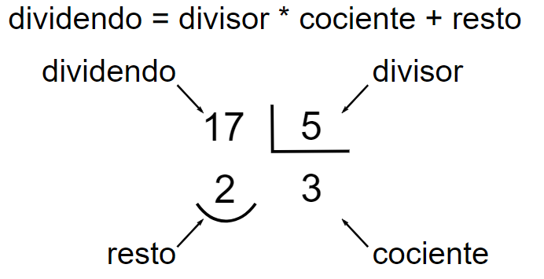
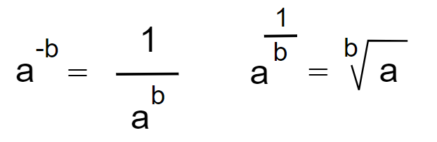

# Números y operaciones aritméticas elementales

## Cociente y resto de una división

El cociente y el resto de una división están relacionados con el dividendo y el divisor mediante la fórmula:

<p align="center">
  
</p>

El cociente es siempre un número entero, pero el resto puede ser entero o decimal. En Python, el resto y el divisor tienen siempre el mismo signo y, en valor absoluto (sin signo), el resto es siempre inferior al divisor.

> **📝 Nota:** como se comenta en la lección [Detalles del Lenguaje](https://www.mclibre.org/consultar/python/lecciones/python-detalles.html#division-enteros), el cociente y el resto de una división en la que intervienen números enteros negativos no se calculan de la misma manera en todos los lenguajes de programación.

### Cociente de una división

El cociente de una división se calcula en Python con el operador `//`. El resultado es siempre un número entero, pero será de tipo entero o decimal dependiendo del tipo de los números empleados (si es decimal, la parte decimal es siempre cero):

```python
print(10 // 3)   # 3
print(10 // 4)   # 2
print(20.0 // 7) # 2.0
print(20 // 6.0) # 3.0
```

El operador cociente `//` tiene la misma prioridad que la división:

```python
print(26 // 5 / 2)   # 2.5
print((26 // 5) / 2) # 2.5
print(26 // (5 / 2)) # 10.0

print(26 / 5 // 2)   # 2.0
print((26 / 5) // 2) # 2.0
print(26 / (5 // 2)) # 13.0
```

### Resto de una división

El resto de una división se calcula en Python con el operador `%`. El resultado tendrá tipo entero o decimal, de acuerdo con el resultado de la operación:

```python
print(10 % 3)   # 1
print(10 % 4)   # 2
print(10 % 5)   # 0
print(10.5 % 3) # 1.5
```

Cuando el resultado es decimal, pueden aparecer problemas de redondeo:

```python
print(10.2 % 3)   # 1.1999999999999993 --> el resultado correcto es 1.2
print(10 % 4.2)   # 1.5999999999999996 --> el resultado correcto es 1.6
print(10.1 % 5.1) # 5.0 --> este resultado coincide con el correcto
```

El operador resto `%` tiene la misma prioridad que la división:

```python
print(26 % 5 / 2)    # 0.5
print((26 % 5) / 2)  # 0.5
print(26 % (5 / 2))  # 1.0

print(26 / 5 % 2)   # 1.2000000000000002
print((26 / 5) % 2) # 1.2000000000000002
print(26 / (5 % 2)) # 26.0
```

---

## Elevar un número a una potencia

Las potencias se calculan con el operador `**`, teniendo en cuenta que `x**y` = x<sup>y</sup>.

Las potencias tienen prioridad sobre las multiplicaciones y divisiones. Al utilizar exponentes negativos o decimales se pueden calcular potencias inversas o raíces n-ésimas:

<p align="center">
  
</p>

```python
print(2**3)     # 8
print(10**-4)   # 0.0001 --> recuerda que a^(-b) = 1 / a^b
print(9**(1/2)) # 3.0    --> recuerda que a^(1/b) es la raíz b-ésima de a
```

También se pueden calcular potencias o raíces con la función integrada `pow(x, y)`. Si se da un tercer argumento, `pow(x, y, z)`, la función calcula primero `x` elevado a `y` y después el resto de la división por `z`:

```python
print(pow(2, 3))    # 8
print(pow(4, 0.5))  # 2.0
print(pow(2, 3, 5)) # 3
```

---

## Redondear un número

Aunque no hay una regla válida para todas las situaciones, normalmente conviene redondear el resultado de un cálculo cuando se muestra al usuario, sobre todo si tiene muchos decimales.

Lo que **nunca** se debe hacer es redondear resultados intermedios que se vayan a utilizar en cálculos posteriores, porque el resultado final será diferente.

### La función integrada `round()`

La función `round()` admite uno o dos argumentos numéricos.

- Con un solo argumento, devuelve el número redondeado al entero más próximo:

```python
print(round(4.35))  #  4
print(round(4.62))  #  5
print(round(-4.35)) # -4
print(round(-4.62)) # -5
```

- Con dos argumentos, siendo el segundo un entero, redondea en la posición indicada por el segundo argumento:
  - Si el segundo argumento es positivo, redondea con ese número de decimales:

```python
print(round(4.3527, 2)) # 4.35
print(round(4.3527, 1)) # 4.4
print(round(4.3527, 3)) # 4.353
```

  - Si se piden más decimales de los que tiene el número, se obtiene el número sin cambios:

```python
print(round(4.3527, 7)) # 4.3527
print(round(435, 2))    # 435
```

  - Si el segundo argumento es `0` y el primero es decimal, se redondea al entero más próximo, pero el resultado es decimal y no entero:

```python
print(round(4.3527, 0)) # 4.0
print(round(4.3527))    # 4
```

  - Si el segundo argumento es `0` y el primero es entero, el resultado es entero:

```python
print(round(435, 0)) # 435
```

  - Si el segundo argumento es negativo, se redondea a decenas, centenas, etc.:

```python
print(round(43527, -1)) # 43530
print(round(43527, -2)) # 43500
print(round(43527, -3)) # 44000
print(round(43527, -4)) # 40000
print(round(43527, -5)) # 0
```

### ⚠️ Redondeo cuando el número está justo en medio

`round()` redondea correctamente al número más próximo. El problema aparece cuando el número está justo en medio (por ejemplo, redondear `3.5` a entero). En Matemáticas se suele redondear siempre hacia arriba, pero Python sigue otro criterio:

- Al redondear a enteros, decenas, centenas, etc., Python redondea de manera que la última cifra sea **par**:

```python
print(round(3.5)) # 4
print(round(4.5)) # 4
print(round(5.5)) # 6
print(round(6.5)) # 6

print(round(450, -2)) # 400
print(round(350, -2)) # 400
print(round(250, -2)) # 200
print(round(150, -2)) # 200
print(round(50, -2))  # 0
```

- Al redondear a décimas, centésimas, etc., Python a veces redondea hacia arriba y otras hacia abajo, por la forma en que se representan internamente los números decimales (ver [Representación de números decimales en binario](https://www.mclibre.org/consultar/python/lecciones/python-operaciones-matematicas.html#decimales-binario)):

```python
print(round(3.15, 1)) # 3.1
print(round(3.25, 1)) # 3.2
print(round(3.35, 1)) # 3.4
print(round(3.45, 1)) # 3.5
print(round(3.55, 1)) # 3.5
print(round(3.65, 1)) # 3.6
```

---

## Otras funciones integradas

### Valor absoluto: `abs()`

Calcula el valor absoluto de un número, es decir, el valor sin signo:

```python
print(abs(-6)) # 6
print(abs(7))  # 7
```

### Máximo: `max()`

Calcula el valor máximo de un conjunto de valores (numéricos o alfabéticos). En cadenas, el máximo es el último valor en orden alfabético, sin importar la longitud:

```python
print(max(4, 5, -2, 8, 3.5, -10))                # 8
print(max("David", "Alicia", "Tomás", "Emilio")) # Tomás
```

Las vocales acentuadas, la `ñ` o la `ç` se consideran posteriores al resto de vocales y consonantes:

```python
print(max("Ángeles", "Roberto")) # Ángeles
```

### Mínimo: `min()`

Calcula el valor mínimo de un conjunto de valores. En cadenas, el mínimo es el primer valor en orden alfabético:

```python
print(min(4, 5, -2, 8, 3.5, -10))                # -10
print(min("David", "Alicia", "Tomás", "Emilio")) # Alicia
print(min("Ángeles", "Roberto"))                 # Roberto
```

### Suma: `sum()`

Calcula la suma de un iterable (tupla, rango, lista, conjunto o diccionario):

```python
print(sum((1, 2, 3, 4, 5))) # 15
print(sum([1, 2, 3, 4, 5])) # 15
print(sum(range(6)))        # 15
print(sum({1, 2, 3, 4, 5})) # 15
```

### Ordenación: `sorted()`

Ordena un iterable. El iterable original no se modifica: la función devuelve una lista nueva con los elementos ordenados:

```python
print(sorted((10, 2, 8, -3, 6))) # [-3, 2, 6, 8, 10]
print(sorted([10, 2, 8, -3, 6])) # [-3, 2, 6, 8, 10]
print(sorted({10, 2, 8, -3, 6})) # [-3, 2, 6, 8, 10]
print(sorted(("David", "Alicia", "Tomás", "Emilio")))           # ['Alicia', 'David', 'Emilio', 'Tomás']
print(sorted(["David", "Ángeles", "Tomás", "Óscar", "Emilio"])) # ['David', 'Emilio', 'Tomás', 'Ángeles', 'Óscar']
```

---

## 📝 Ejercicios propuestos

1. **Kilómetros a metros.** Dada una distancia `d` expresada en kilómetros, conviértela a metros.
   [Ver problema en HackerRank](https://www.hackerrank.com/contests/campamento-urbano-dia-1/challenges/kilometros-a-metros)

2. **Expresar horas y minutos en minutos.** Dada una hora en formato `hh:mm`, exprésala en minutos totales. Por ejemplo, `02:30` son `150` minutos.
   [Ver problema en HackerRank](https://www.hackerrank.com/contests/campamento-urbano-dia-1/challenges/expresar-horas-y-minutos-en-minutos)

3. **Centígrados a Fahrenheit.** Dada una temperatura en grados centígrados, conviértela a grados Fahrenheit usando la fórmula `F = 9/5 · C + 32`.
   [Ver problema en HackerRank](https://www.hackerrank.com/contests/campamento-urbano-dia-1/challenges/convertir-grados-centigrados-a-grados-fahrenheit)

4. **Distancia Manhattan.** La distancia entre dos puntos con coordenadas enteras en una grilla rectangular se calcula con la fórmula `D = |x1 - x2| + |y1 - y2|`. Dadas las coordenadas de dos puntos, calcula su distancia Manhattan.
   [Ver problema en HackerRank](https://www.hackerrank.com/contests/campamento-urbano-dia-1/challenges/distancia-manhatan/problem)

5. **Área del triángulo.** Dadas las longitudes de los tres lados de un triángulo, calcula su área usando la fórmula de Herón: semiperímetro `S = (a + b + c) / 2` y área `A = √(S(S - a)(S - b)(S - c))`.
   [Ver problema en HackerRank](https://www.hackerrank.com/contests/campamento-urbano-dia-1/challenges/area-del-triangulo-conocidos-los-tres-lados)

6. **Suma los dígitos.** Dado un número `n` de tres cifras, halla la suma del número formado por los dos dígitos de los extremos más el dígito del centro. Por ejemplo, para `257`: `27 + 5 = 32`.
   [Ver problema en HackerRank](https://www.hackerrank.com/contests/campamento-urbano-dia-1/challenges/suma-los-digitos-de-los-extremos-y-el-del-centro/problem)

7. **Número incluido.** Se llama incluido al número que se obtiene sumando las cifras de un número dado. Por ejemplo, el incluido de `124` es `7`, porque `1 + 2 + 4 = 7`. Dado un número `n`, determina su número incluido.
   [Ver problema en HackerRank](https://www.hackerrank.com/contests/campamento-urbano-dia-1/challenges/numero-incluido)

## 📝 [Problemas: Clase 0.1 – Números y operaciones aritméticas elementales](https://www.hackerrank.com/contests/campamento-urbano-dia-1/challenges)
