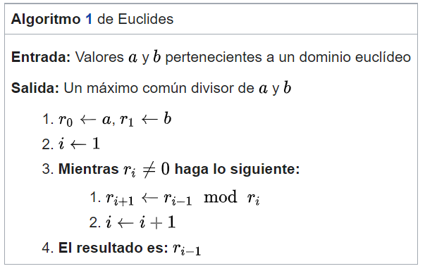

# Ciclos `for` y `while`

Los ciclos (bucles) se usan cuando necesitamos repetir un conjunto de instrucciones muchas veces. Python tiene dos tipos de ciclos: `for` y `while`.

- El ciclo `for` es la opción más sencilla cuando sabes **cuántas veces** hay que repetir.
- El ciclo `while` es la opción más sencilla cuando hay que repetir **hasta que se cumpla una condición**.

---

## Sintaxis del ciclo `for`

El ciclo `for` recorre los elementos de un objeto iterable y ejecuta un bloque de código por cada elemento. Son iterables, entre otros:

- `list`
- `tuple`
- `dict`
- `set`
- `str`

```python
for elemento in iterable:
    # Tu código aquí
```

`elemento` toma, en cada paso, el valor de un elemento del iterable. El ciclo termina cuando se recorren todos los elementos.

### Ciclo `for` en listas

Supongamos que queremos recorrer una lista de números e imprimir los que sean primos.

> **📝 Nota:** un número `n > 1` es primo si solo es divisible por `1` y por `n`. Para saberlo basta con comprobar que no sea divisible por ningún entero `i` con `2 ≤ i ≤ √n`.

```python
lista = [2, 1000000007, 10000, 4, 7, 101, 11, 4971, 24, 17, 108, 111, 25]
for x in lista:
    es_primo = True
    for i in range(2, int(x**(1/2)) + 1):
        if x % i == 0:
            es_primo = False
    if es_primo:
        print(x)
# 2  1000000007  7  101  11  17
```

### Ciclo `for` en diccionarios

Un diccionario está formado por pares clave/valor, así que hay varias formas de recorrerlo:

1. Recorrer las claves:

```python
valores = {'A': 4, 'E': 3, 'I': 1, 'O': 0}
for k in valores:
    print(k)
# A  E  I  O
```

2. Recorrer los valores:

```python
valores = {'A': 4, 'E': 3, 'I': 1, 'O': 0}
for v in valores.values():
    print(v)
# 4  3  1  0
```

3. Recorrer a la vez la clave y el valor:

```python
valores = {'A': 4, 'E': 3, 'I': 1, 'O': 0}
for k, v in valores.items():
    print('k =', k, ', v =', v)
# k = A , v = 4
# k = E , v = 3
# ...
```

---

## Ciclo `for` y la clase `range`

Para recorrer una secuencia numérica usamos `range`. `range(max)` genera los valores desde `0` hasta `max - 1`:

```python
for i in range(11):
    print(i)
# 0  1  2  ...  10
```

`range` se puede usar con uno, dos o tres parámetros:

- `range(max)`: enteros consecutivos desde `0` hasta `max - 1`.
- `range(min, max)`: enteros consecutivos desde `min` hasta `max - 1`.
- `range(min, max, paso)`: enteros desde `min` hasta `max - 1`, avanzando de `paso` en `paso`.

Por ejemplo, para mostrar los números pares del `0` al `10`:

```python
for num in range(0, 11, 2):
    print(num)
# 0  2  4  6  8  10
```

---

## Ciclo `for` con `break` y `continue`

- `break` termina el ciclo y sale de él, por ejemplo, cuando se cumple alguna condición.
- `continue` salta al siguiente paso de la iteración, ignorando el resto de instrucciones del ciclo.

Mejoremos el algoritmo de los primos con `break`: en cuanto encontramos un divisor, ya sabemos que no es primo.

```python
lista = [2, 1000000007, 10000, 4, 7, 101, 11, 4971, 24, 17, 108, 111, 25]
for x in lista:
    es_primo = True
    for i in range(2, int(x**(1/2)) + 1):
        if x % i == 0:
            es_primo = False
            break  # tiene al menos un divisor, no es primo
    if es_primo:
        print(x)
```

Con `continue` podemos imprimir solo los números pares de una lista:

```python
lista = [2, 4, 5, 7, 8, 9, 3, 4]
for x in lista:
    if x % 2 != 0:
        continue
    print(x)
# 2  4  8  4
```

---

## Ciclo `for` con `else`

Python permite añadir un bloque `else` a un ciclo `for`:

```python
for i in iterable:
    # Tu código aquí
else:
    # Se ejecuta solo si el ciclo NO terminó con break
```

```python
numeros = [1, 2, 4, 3, 5, 8, 6]
for n in numeros:
    if n == 3:
        break
else:
    print('No se encontró el número 3')
```

Como la lista contiene el `3`, se ejecuta el `break` y el `print` nunca se ejecuta.

---

## Sintaxis del ciclo `while`

El ciclo `while` repite un bloque de instrucciones **mientras** una condición sea verdadera. La gran diferencia con `for` es cómo decide Python cuántas veces repetir:

```python
while condicion:
    # Tu código
    # No olvides modificar algo que afecte a la condición
```

**Ejemplo:** el [máximo común divisor](https://es.wikipedia.org/wiki/M%C3%A1ximo_com%C3%BAn_divisor) (MCD) de dos enteros es el mayor entero que divide a ambos sin dejar residuo. Para calcularlo se usa el [algoritmo de Euclides](https://es.wikipedia.org/wiki/Algoritmo_de_Euclides). En pseudocódigo, `x mod y` significa "el resto de dividir `x` entre `y`":

<p align="center">
  
</p>

```python
def mcd(a, b):
    while a != 0:
        a, b = b % a, a
    return b

a = 25
b = 45
print("El MCD de {} y {} es {}".format(a, b, mcd(a, b)))
# El MCD de 25 y 45 es 5
```

> 👉 El MCD y el algoritmo de Euclides se estudian en profundidad en la [Clase 3](../modulo-1-matematicas-y-fundamentos-basicos/03-maximo-comun-divisor-mcd-y-minimo-comun-multiplo-mcm.md).

---

## Ciclo `while` con `else`

El `else` también funciona con `while`: se ejecuta cuando la condición deja de ser verdadera (y el ciclo no terminó con `break`):

```python
def mcd(a, b):
    x, y = a, b
    while x != 0:
        x, y = y % x, x
    else:
        print("El MCD de {} y {} es {}".format(a, b, y))
    return y

mcd(25, 45)
# El MCD de 25 y 45 es 5
```

---

## Ciclo `while` con `break` y `continue`

`break` termina el ciclo antes de tiempo, aunque la condición siga siendo verdadera:

```python
a = 0
while a < 10:
    a += 1
    if a % 2 == 0:
        break
    print(a)
print('El bucle ha finalizado')
# 1
# El bucle ha finalizado
```

`continue`, en lugar de terminar el ciclo, salta al paso siguiente:

```python
a = 0
while a < 10:
    a += 1
    if a % 2 == 0:
        continue
    print(a)
print('El bucle ha finalizado')
# 1  3  5  7  9
# El bucle ha finalizado
```

---

## 📝 Ejercicios propuestos

1. **Suma de los n primeros números de Fibonacci.** La [sucesión de Fibonacci](https://es.wikipedia.org/wiki/Sucesi%C3%B3n_de_Fibonacci) es `1, 1, 2, 3, 5, 8, 13, 21, 34, 55, ...`. Calcula la suma de sus `n` primeros números.
   [Ver problema en HackerRank](https://www.hackerrank.com/contests/ciclos-for-y-while/challenges/suma-de-los-n-primeros-numeros-de-la-sucesion-de-fibonacci)

2. **Número de términos.** Calcula cuántos términos de la serie `1² + 2² + 3² + 4² + ...` hay que sumar para que la suma sea mayor que un número `x`.
   [Ver problema en HackerRank](https://www.hackerrank.com/contests/ciclos-for-y-while/challenges/numero-de-terminos)

3. **Forma de diamante.** Imprime la siguiente forma de diamante, recibiendo como dato la cantidad `n` de `*` de la fila central:

   ```text
         *
       * * *
     * * * * *
   * * * * * * *
     * * * * *
       * * *
         *
   ```

   [Ver problema en HackerRank](https://www.hackerrank.com/contests/ciclos-for-y-while/challenges/forma-de-diamante)

4. **Números perfectos 3.** Un número perfecto es aquel igual a la suma de sus divisores (sin contarse a sí mismo). Por ejemplo, `28 = 14 + 7 + 4 + 2 + 1`. Dados dos enteros `a` y `b`, imprime todos los números perfectos del rango `[a, b]`.
   [Ver problema en HackerRank](https://www.hackerrank.com/contests/ciclos-for-y-while/challenges/numeros-perfectos-3-1)

5. **Mínimo común múltiplo 2.** El [mínimo común múltiplo](https://es.wikipedia.org/wiki/M%C3%ADnimo_com%C3%BAn_m%C3%BAltiplo) (MCM) de `a` y `b` es el menor múltiplo común de ambos. Conociendo el MCD, se calcula como `MCM = a · b / MCD(a, b)`. Dados dos enteros `a` y `b`, calcula su MCM.
   [Ver problemas del tema en HackerRank](https://www.hackerrank.com/contests/ciclos-for-y-while/challenges)

6. **Conjetura de Ullman.** Dado un entero `n > 1`, la [conjetura de Ullman](https://es.wikipedia.org/wiki/Conjetura_de_Collatz) (o de Collatz) aplica repetidamente esta operación:
   - Si el número es par, se divide entre `2`.
   - Si el número es impar, se multiplica por `3` y se suma `1`.

   Por ejemplo, empezando en `26` la secuencia es `13, 40, 20, 10, 5, 16, 8, 4, 2, 1` (10 pasos). Dado un entero `n`, calcula la cantidad de pasos hasta llegar a `1`.
   [Ver problema en HackerRank](https://www.hackerrank.com/contests/ciclos-for-y-while/challenges/conjetura-de-ullman)

## 📝 [Problemas: Clase 0.2 – Ciclos for y while](https://www.hackerrank.com/contests/ciclos-for-y-while/challenges)
